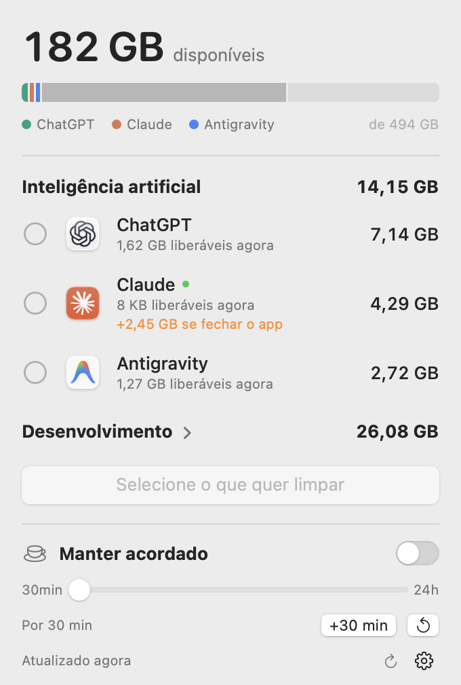

# Folga — free up disk space used by AI apps and developer caches on macOS

**Folga** is a free, open-source macOS menu bar app that shows how much disk space AI apps
(ChatGPT/Codex, Claude, Antigravity) and developer tools (npm, pnpm, uv, Docker, Hugging Face models,
Playwright…) are using, and safely cleans their caches with two confirmations. It also keeps your
Mac awake with a menu bar countdown.

Native SwiftUI · Apple silicon · macOS 14+ · auto-updates via Sparkle · MIT license

[English](#english) · [Português](#português)

<p align="center">
  <picture>
    <source media="(prefers-color-scheme: dark)" srcset="docs/images/folga-dark.png">
    
  </picture>
</p>

---

## English

### Why Folga

AI desktop apps and dev toolchains quietly eat tens of gigabytes: Electron caches, old Claude Code
versions, Codex session logs, npm and pnpm stores, uv wheels, Hugging Face and Whisper models,
outdated Playwright browsers, Docker images. Folga puts all of that in one small menu bar window,
tells you what is safe to remove, and removes only what you pick.

### Features

- **Disk meter in the menu bar**: free space at a glance, with a storage bar per AI app.
- **AI apps**: ChatGPT / Codex, Claude (desktop + Claude Code), Antigravity. Shows app size, cache,
  chat history and what you could free right now, including cache locked by an open app.
- **Developer caches**: pnpm, npm (+ npx), Node (node-gyp, Corepack, nvm), Python (uv + pip), Bun,
  Docker (`system prune`, never volumes), Hugging Face models, Playwright + Puppeteer browsers, Whisper models.
- **Safe by design**: nothing is selected by default, double confirmation before anything is removed,
  Enter never triggers a cleanup, caches of running apps are left alone (or Folga closes and reopens
  the app, if you ask), old chats go to the Trash, and nothing outside your home folder is ever touched.
- **Keep awake**: prevents display sleep, screen saver and idle lock for 30 min to 24 h, with
  +30 min and reset buttons and a compact countdown in the menu bar (`2h15`, `29m`).
- **Auto-updates** through [Sparkle](https://sparkle-project.org), with EdDSA-signed releases.

### Install

1. Download the latest `.dmg` from [Releases](https://github.com/guilhermemarketing/folga/releases).
2. Drag **Folga** to Applications and open it.
3. Folga isn't notarized by Apple, so the first time go to **System Settings → Privacy & Security →
   Open Anyway** (or run `xattr -dr com.apple.quarantine /Applications/Folga.app`).

Updates arrive automatically after that. The UI is in Brazilian Portuguese for now; translations are welcome.

### What gets cleaned

| Item | Removed | How |
|---|---|---|
| ChatGPT, Claude, Antigravity: cache | Chromium/Electron caches, `~/Library/Caches/<app>`, logs, old Claude Code versions, pending updates | Deleted (apps rebuild them) |
| ChatGPT, Claude, Antigravity: chats | Codex, Claude Code (except `memory/`) and Antigravity sessions unused for N days (7/30/90) | Moved to Trash |
| pnpm | Metadata cache and old store versions, then `pnpm store prune` | Deleted |
| npm | `_cacache`, logs, npx packages unused for 7+ days | Deleted |
| Node | node-gyp headers, Corepack and nvm caches | Deleted |
| Python (uv) | uv and pip caches (environments and installed Pythons stay) | Deleted |
| Bun | Package cache | Deleted |
| Docker | `docker system prune -a` + `builder prune` (volumes never), needs Docker running | Removed by Docker |
| Hugging Face | Downloaded models and datasets (except Whisper); blobs shared between models stay | Deleted |
| Playwright + Puppeteer | Old browser builds; the newest of each stays | Deleted |
| Whisper | Whisper models from Hugging Face and openai-whisper | Deleted |

Every path lives in [`Sources/Folga/Catalog.swift`](Sources/Folga/Catalog.swift).

### Contributing

Folga is open source and contributions are very welcome: new apps and tools to measure (Cursor,
Windsurf, Ollama, LM Studio, Xcode DerivedData…), translations, bug fixes and UI polish.
See [CONTRIBUTING.md](CONTRIBUTING.md). Adding a new cache is usually a few lines in `Catalog.swift`.

Build from source with just the Command Line Tools (`xcode-select --install`):

```bash
git clone https://github.com/guilhermemarketing/folga.git && cd folga
swift build -c release
.build/release/Folga --report   # what Folga sees on your Mac, as text
./scripts/build.sh              # dist/Folga.app
```

### License

[MIT](LICENSE). Not affiliated with OpenAI, Anthropic, Google or any tool vendor; names and icons belong to their owners.

---

## Português

Medidor de disco na barra de menus do macOS (Apple silicon, macOS 14+) para o que as IAs e as
ferramentas de desenvolvimento ocupam. Mostra o espaço livre e quanto cada uma pesa, e libera espaço
com seleção explícita e dupla confirmação. Também tem um "Manter acordado" com cronômetro.

- **IAs:** ChatGPT/Codex, Claude e Antigravity
- **Desenvolvimento:** pnpm, npm, Node, Python (uv + pip), Bun, Docker, modelos Hugging Face,
  Playwright + Puppeteer e Whisper

### Instalar

Baixe o `.dmg` mais recente em [Releases](https://github.com/guilhermemarketing/folga/releases),
arraste o Folga para Aplicativos e abra. O app não tem assinatura paga da Apple, então, na primeira vez,
vá em **Ajustes do Sistema → Privacidade e Segurança → Abrir Mesmo Assim** (ou rode
`xattr -dr com.apple.quarantine /Applications/Folga.app`).

Depois disso, as atualizações chegam sozinhas pelo Sparkle (checagem diária; ⚙︎ → **Procurar
atualizações…** força agora). Em ⚙︎ também dá para ligar **Abrir ao iniciar sessão** e escolher o que
conta como conversa antiga (7, 30 ou 90 dias).

### O que ele limpa

Clique nos itens da tela principal (o círculo vira ✓), toque em **Revisar limpeza**, escolha cache
e/ou conversas, **Continuar** e, na segunda tela, **Limpar agora**. Enter nunca dispara a limpeza.
A tabela acima (em inglês) lista cada item. O cache de um app aberto não é tocado (o Folga pode
fechar, limpar e reabrir, se você pedir). Configurações, login, cookies, memórias e imagens geradas
nunca são tocados.

### Manter acordado

Liga/desliga, de 30 min a 24 h. Enquanto ligado, a tela não apaga, a proteção de tela não entra e a
sessão não bloqueia por inatividade (⌃⌘Q continua funcionando). **+30 min** soma meia hora (desligado,
liga por 30 min); **↺** volta para 30 min contando de agora. A barra de menus mostra o tempo restante.

### Desenvolvimento

Só precisa das Command Line Tools (`xcode-select --install`).

```bash
swift build -c release
.build/release/Folga --report                 # o que o app enxerga, em texto
.build/release/Folga --snapshot /tmp/folga    # renderiza as telas em PNG (claro e escuro)
.build/release/Folga --awake-test             # liga por 6s; confira com: pmset -g assertions
FOLGA_HOME=/tmp/casa-falsa .build/release/Folga --clean-test   # limpeza só numa home falsa
./scripts/build.sh                            # dist/Folga.app
./scripts/make-dmg.sh                         # dist/Folga-<versão>.dmg
```

### Publicar uma versão (mantenedor)

1. Aumente `MARKETING_VERSION` e `BUILD_NUMBER` em `version.env`.
2. `./scripts/release.sh "O que mudou"`: gera e assina o DMG, cria o release no GitHub,
   adiciona a versão ao `appcast.xml` e faz push.

Isso precisa, no Mac que publica, da chave EdDSA do Sparkle no Keychain (conta `marketing.gui.folga`;
para importar: `.sparkle/bin/generate_keys --account marketing.gui.folga -f backup.txt`) e do
certificado "Folga Local Signing" (importe o `.p12`). Sem o certificado, o build sai ad-hoc e não
serve como atualização.
